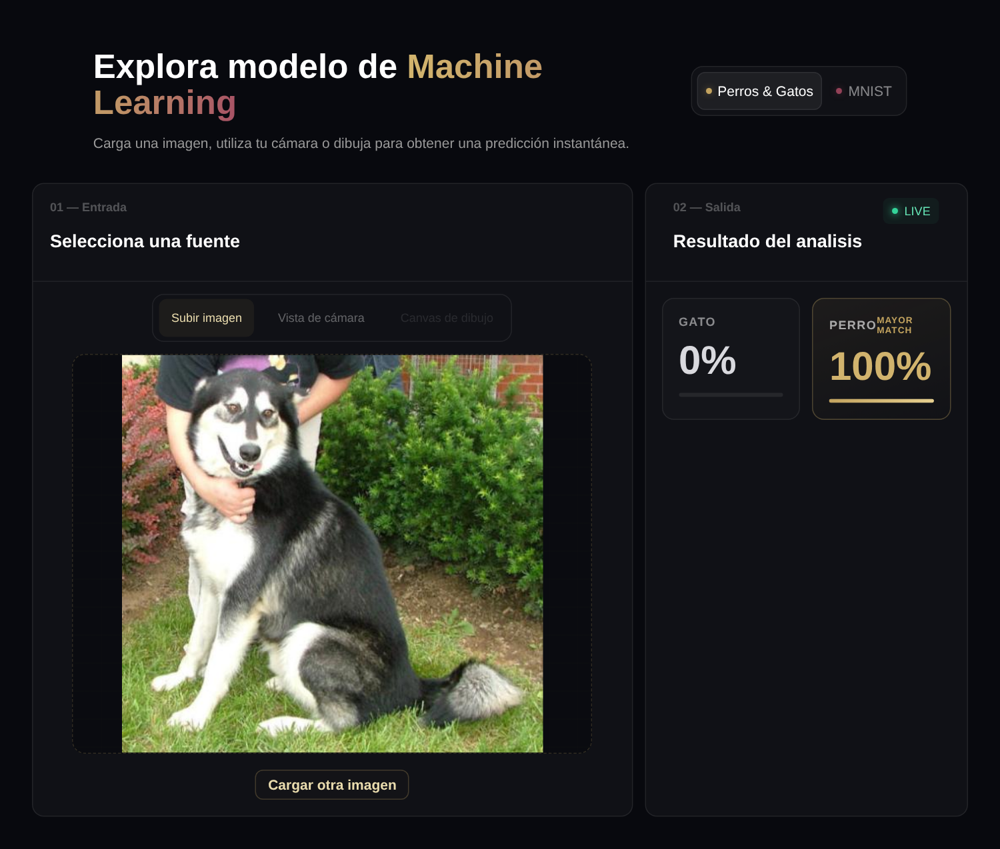
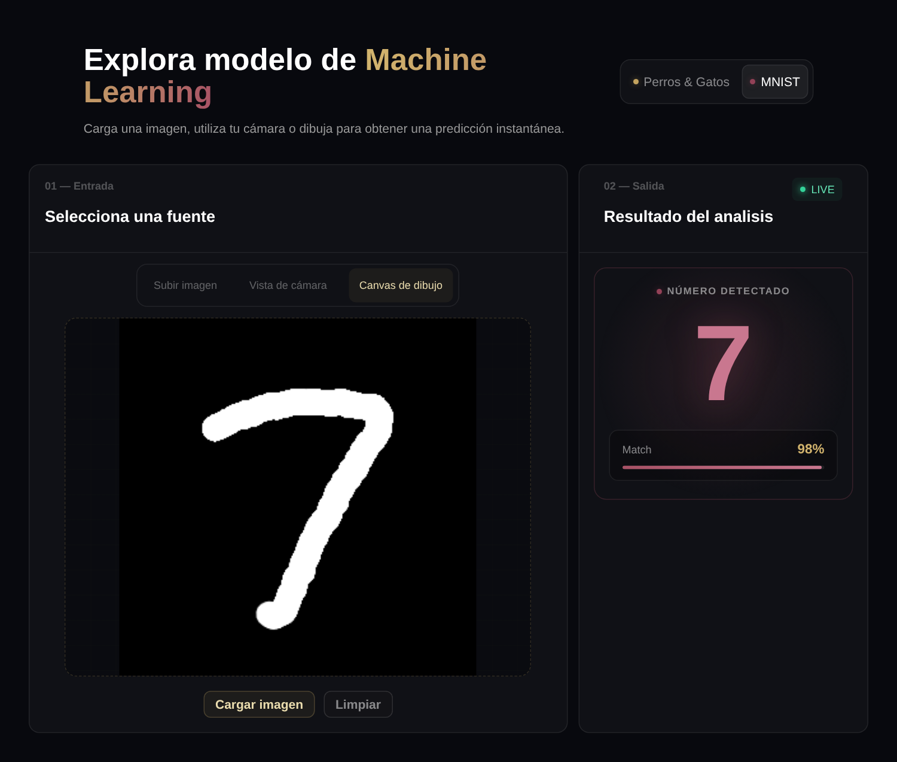

<p align="center">
  
</p>

<h1 align="center">CSLab · cs1-ws-lab1-de</h1>

<p align="center">
  App de escritorio en <b>Electron</b> para probar los modelos de Machine Learning de la API
  <a href="https://github.com/julian-bc/cs1-ws-lab1"><code>cs1-ws-lab1</code></a>:
  <b>Perros & Gatos</b> y <b>MNIST</b> (dígitos escritos a mano).
</p>

<p align="center">
  
  
  
</p>

Carga una imagen, usa la cámara o dibuja un número, y la app envía la imagen a la API y muestra la predicción al instante.

## Contenido

- [Funcionalidades](#funcionalidades)
- [Capturas](#capturas)
- [Requisitos](#requisitos)
- [Ejecución paso a paso](#ejecución-paso-a-paso)
- [Configuración](#configuración)
- [Estructura del proyecto](#estructura-del-proyecto)

## Funcionalidades

| Modelo | Endpoint | Fuentes de entrada | Resultado |
| :--- | :--- | :--- | :--- |
| **Perros & Gatos** | `POST /catsdogs` | Subir imagen · Cámara | Porcentaje de gato y de perro, con el mayor match resaltado |
| **MNIST** | `POST /mnist` | Subir imagen · Cámara · Canvas de dibujo | Dígito detectado (0-9) y su porcentaje de confianza |

- **Subir imagen:** PNG, JPG, WEBP o BMP de hasta **5 MB**.
- **Vista de cámara:** activa la webcam y captura un fotograma para analizarlo.
- **Canvas de dibujo:** dibuja un número con el mouse (solo MNIST) y envíalo con **Cargar imagen**.

## Capturas

| Perros & Gatos | MNIST con el canvas de dibujo |
| :---: | :---: |
|  |  |

## Requisitos

| Herramienta | Versión |
| :--- | :--- |
| [Node.js](https://nodejs.org/) (incluye npm) | 20 o superior (LTS recomendado) |
| [Git](https://git-scm.com/) | Cualquiera reciente |
| API key | La de la API `cs1-ws-lab1` (ver [Configuración](#configuración)) |

Electron se instala con `npm install`; no hace falta instalarlo aparte.

## Ejecución paso a paso

**1. Clonar el repositorio**

```bash
git clone https://github.com/julian-bc/cs1-ws-lab1-de.git
cd cs1-ws-lab1-de
```

**2. Instalar dependencias**

```bash
npm install
```

**3. Crear el archivo `.env`** a partir del ejemplo

```bash
# Linux / macOS / Git Bash
cp .env.example .env

# Windows (PowerShell)
Copy-Item .env.example .env
```

**4. Poner tu API key** en el `.env`

```env
API_KEY=tu_api_key_aqui
```

**5. Ejecutar la app**

```bash
npm start
```

Se abre la ventana **CSLab**. Elige el modelo arriba a la derecha (**Perros & Gatos** o **MNIST**), luego una fuente de entrada, y el resultado aparece en el panel **02 — Salida**.

## Configuración

La app se conecta a la API desplegada en Azure:

| Parámetro | Valor |
| :--- | :--- |
| URL base | `https://cs1-lab1.mexicocentral.cloudapp.azure.com` |
| Autenticación | Cabecera `x-api-key: <API_KEY>` |
| Body | `multipart/form-data` con el campo `image` |

Variables del archivo `.env`:

| Variable | Obligatoria | Descripción |
| :--- | :---: | :--- |
| `API_KEY` | Sí | Llave de la API. Es el mismo valor que `CS1_API_LAB_1` en el servidor de [`cs1-ws-lab1`](https://github.com/julian-bc/cs1-ws-lab1). |
| `DEBUG_API` | No | Con `DEBUG_API=1` se imprime en la terminal un log de cada petición. Al ejecutar con `npm start` los logs ya están activos. |

Equivalente con `curl` de lo que hace la app:

```bash
curl -H "x-api-key: <API_KEY>" -F "image=@perro.jpg" https://cs1-lab1.mexicocentral.cloudapp.azure.com/catsdogs
```

## Estructura del proyecto

```
cs1-ws-lab1-de/
├── main.js          # Proceso principal: ventana, permisos y llamada a la API
├── preload.js       # Puente seguro: expone window.api.predict
├── renderer.js      # Lógica de la interfaz: modelos, cámara, canvas y resultados
├── index.html       # Estructura de la interfaz
├── styles.css       # Estilos
├── .env.example     # Plantilla de variables de entorno
├── docs/img/        # Capturas del README
└── package.json
```
